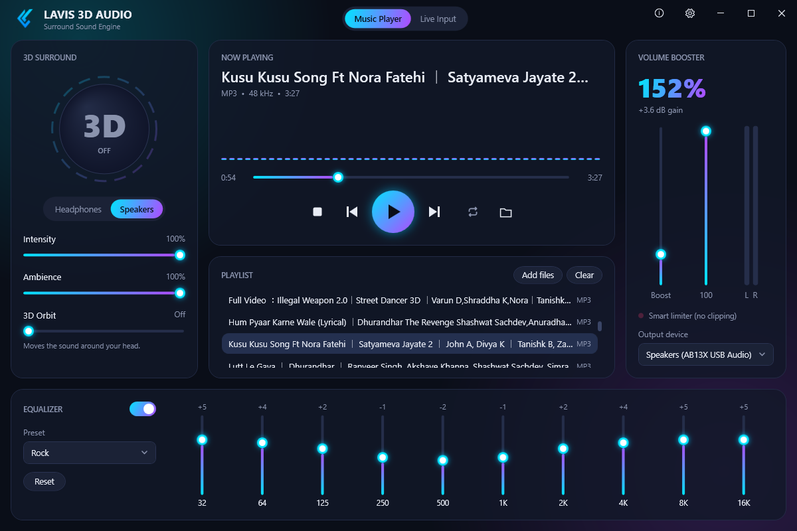

# LAVIS 3D AUDIO

### Experience Music in Three Dimensions.

A free and open-source Windows audio player with virtual surround sound, equalizer, live audio processing and volume enhancement.



[Download Latest Version](../../releases/latest)

[Features](#features) |
[Installation](#installation) |
[Build from Source](#build-from-source) |
[License](LICENSE)

Put together by [Lavistech Solutions](https://lavistech.com/). Current version: **1.0.0.51**. Windows PC, 64-bit.

## Features

- **3D surround** using [Steam Audio](https://github.com/ValveSoftware/steam-audio) HRTF. A front image, rear image, and optional orbit sit around the listener. Headphones and speakers each have their own spatial blend.
- **Intensity, ambience, and 3D Orbit.** Intensity widens the image, ambience adds space, and orbit moves the centre of the sound around your head. Orbit off leaves the image still.
- **Music player** for MP3, WAV, FLAC, M4A, AAC, WMA, and AIFF. Playlist, seek, repeat (once, a set number of times, or endless) for the current track or the whole playlist.
- **Live input.** Capture a single application (Windows 10 version 2004 or later), a recording device, or the audio already going to a playback device.
- **All PC sound.** When an FxSound virtual playback device is installed, Live Input can route other programs through Lavis 3D Audio and send the result to the output device you pick. Stopping returns the previous Windows default device.
- **Volume booster** from 100% to 400% (0 to +12 dB) with a peak limiter, plus a separate output volume and left/right meters.
- **10-band equalizer** (32 Hz to 16 kHz, ±12 dB) with presets: Flat, Bass Boost, Treble Boost, Vocal, Rock, Pop, Jazz, Classical, Electronic, and Movie.
- **Settings** for output device, listening mode, live source, loop, and what is remembered between sessions. Saved to `%AppData%\Lavis3DAudio\settings.json`.

## Installation

Windows PC, 64-bit (Windows 10 or Windows 11).

### Windows installer

Recommended for normal users.

1. Download the Windows installer from the [latest release](../../releases/latest).
2. Run the installer and follow the prompts.
3. Start Lavis 3D Audio from the Start menu.

This release is framework-dependent, so the [.NET 10 Desktop Runtime](https://dotnet.microsoft.com/download/dotnet/10.0) has to be installed. If it is missing, install it before you run the app. A self-contained release would include the runtime and would not need this step. The current publish profile is not self-contained.

`phonon.dll` is installed next to `Lavis3DAudio.exe`. Leave it there. The license PDFs in `docs` are the ones opened from the About window.

All PC sound needs the FxSound virtual playback device. The music player and the other live sources do not.

### Build from source

Recommended for developers. The steps are in [Build from Source](#build-from-source).

## Build from Source

Install the [.NET 10 SDK](https://dotnet.microsoft.com/download/dotnet/10.0). The SDK includes the runtime used to run a local build, so a separate Desktop Runtime install is not required on the machine you build on. Steam Audio’s `phonon.dll` is not in this repository. Download [Steam Audio 4.8.1](https://github.com/ValveSoftware/steam-audio/releases) for Windows 64-bit and copy `phonon.dll` to:

```text
native/win-x64/phonon.dll
```

From this directory:

```powershell
dotnet build -c Release
```

The executable is written to `bin\Release\net10.0-windows\`, with `phonon.dll` and the `docs` folder beside it.

`dotnet build` produces a framework-dependent program. Another PC needs the .NET 10 Desktop Runtime to run that output.

A self-contained build carries the runtime with it, so the target PC does not need .NET installed:

```powershell
dotnet publish -c Release -r win-x64 --self-contained true -p:PublishSingleFile=true
```

`phonon.dll` is still a separate file next to the published executable.

## Third-party software

| Component | Version | License |
| --- | --- | --- |
| [Steam Audio](https://github.com/ValveSoftware/steam-audio) (`phonon.dll`) | 4.8.1 | [Apache License 2.0](docs/SteamAudio-Apache-2.0.txt) |
| [NAudio](https://github.com/naudio/NAudio) | 2.2.1 | [MIT License](docs/NAudio-MIT.txt) |

The same texts are included as PDFs in `docs` and linked from About inside the app.

## License

Lavis 3D Audio is covered by the [MIT License](LICENSE). Third-party components keep their own licenses.

## Feedback

[lavistech.com/contact](https://lavistech.com/contact)
